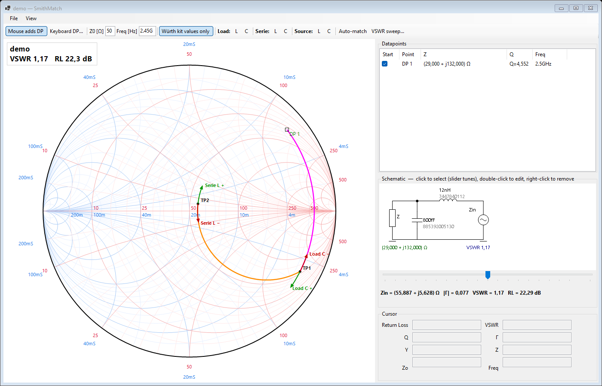
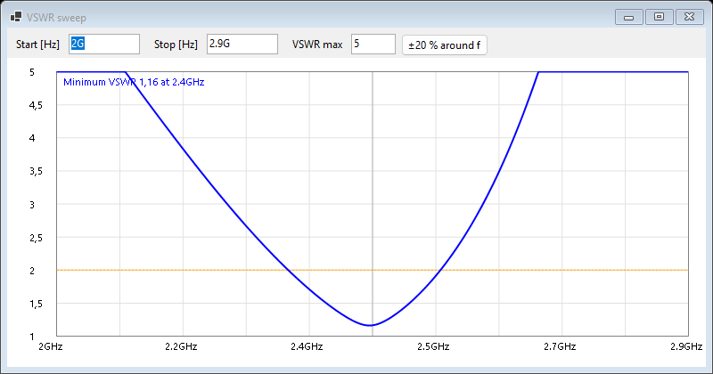
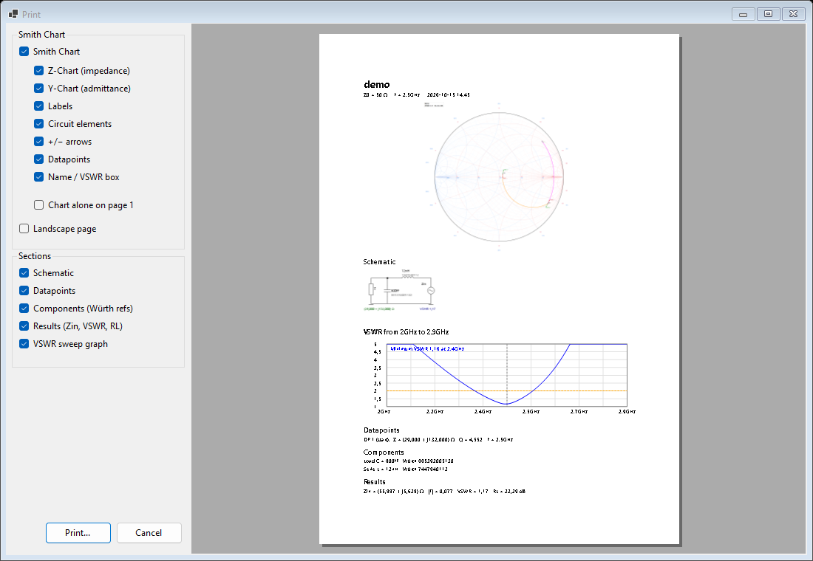

# SmithMatch – RF matching tool on a Smith chart

A Windows desktop tool (C# / WinForms, .NET 10) for designing **antenna and RF impedance matching networks** on an interactive Smith chart, inspired by the classic *Smith* program.

You enter the impedance of your load (e.g. an antenna measured with a VNA), add L/C components to a pi network, and see live how each component moves the impedance towards 50 Ω. Values can be limited to the parts in the **Würth Elektronik design kits**, so the result can be built straight away on the bench.



## Features

**Smith chart**
- Impedance (Z) and admittance (Y) grids, scaled to any Z0, with zoom (mouse wheel)
- Datapoints by mouse click or by typing R + jX
- Cursor readout: return loss, VSWR, Q, Γ (magnitude / angle), Z, Y
- Live VSWR and return loss of the whole network in the corner of the chart

**Matching network**
- Fixed pi topology: **Load L / C** (to ground) → **Serie L / C** → **Source L / C** (to ground)
- Schematic drawn like the circuit, with values and part numbers
- **Place a component with the mouse**: a circle shows every point the component can reach, the value follows the mouse, click to fix, ESC to cancel
- **Slider tuning** of the selected component
- **+ / − arrows** at each point showing where the impedance moves when a value is increased or decreased – handy to know which way to go when tuning on the bench
- **Auto-match**: lists every L-network solution (low-pass / high-pass), with live preview and the VSWR actually reached

**Würth Elektronik kits**
- "Würth kit values only" mode snaps every value to the nearest kit value
- Inductors: **WE-MK 0402**, design kit 744784 (33 values, 1–270 nH)
- Capacitors: **WCAP-CSRF 0402**, design kit 885390 (36 NP0 values, 0.2–27 pF)
- Würth order codes shown in the schematic, the Auto-match list and the printout

**Analysis and output**
- **VSWR sweep**: VSWR versus frequency over a user-defined range, with minimum VSWR and cursor readout (the load is modelled as R + equivalent L or C found at the design frequency)
- **Print** dialog with live preview: choose the chart layers (Z/Y grid, labels, traces, arrows, datapoints) and sections (schematic, datapoints, components, results, VSWR sweep); chart can fill page 1 on its own; portrait or landscape
- Export the chart as PNG
- **Save / Open** designs as `.smith` files (JSON)

## Screenshots

**VSWR versus frequency**



**Print dialog with live preview**



## Getting started

Requirements: Windows and the [.NET 10 SDK](https://dotnet.microsoft.com/download).

```bash
git clone https://github.com/lwathelet/SmithMatch.git
cd SmithMatch
dotnet run
```

A design can also be opened from the command line: `SmithMatch.exe mydesign.smith` (try `docs/demo.smith`).

The README images are generated by the program itself: `SmithMatch.exe docs/demo.smith --screenshots docs`.

## How to use

1. Set **Z0** and the **frequency** in the toolbar (values accept suffixes: `2.45G`, `3.3n`, `1.5p`).
2. Add your load: click on the chart, or use **Keyboard DP...** to type R and X.
3. Click a component button (**Load / Serie / Source – L / C**), move the mouse along the green circle and click to fix the value.
4. Or press **Auto-match** and choose one of the proposed solutions.
5. Turn on **Würth kit values only** to keep only parts you have in the kit, then fine-tune with the slider and the +/− arrows.
6. Check the bandwidth with **VSWR sweep...**, then save and print.

## Project structure

| File | Content |
|---|---|
| `MainForm.cs` | Main window, network calculation, auto-match, placing, files, printing |
| `SmithChartControl.cs` | Smith chart drawing (grids, traces, arrows, locus circle) |
| `SchematicControl.cs` | Pi network schematic |
| `SweepForm.cs` | VSWR versus frequency window |
| `PrintOptionsForm.cs` | Print options with live preview |
| `Kits.cs` | Würth design kit values and order codes |
| `Model.cs` | Components, RF formulas, engineering number format |

## Notes

- Würth values and order codes were taken from the kit datasheets ([744784](https://www.we-online.com/catalog/datasheet/744784.pdf), [885390](https://www.we-online.com/catalog/datasheet/885390.pdf)); check the current datasheets before ordering.
- Components are ideal (no parasitics, no Q losses, no self-resonance).
- This project is not affiliated with Würth Elektronik or with the authors of the Smith program.

## License

[MIT](LICENSE) © 2026 Luc Wathelet
